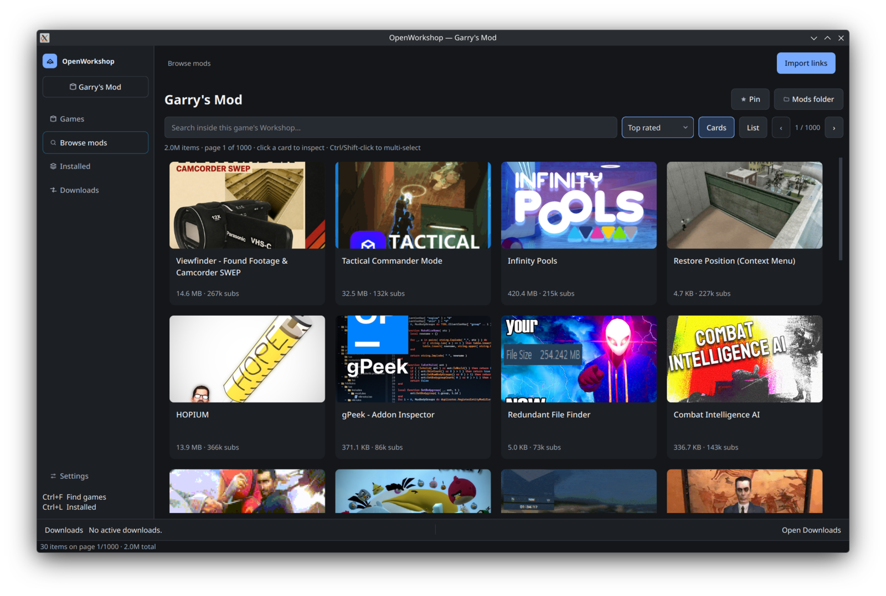
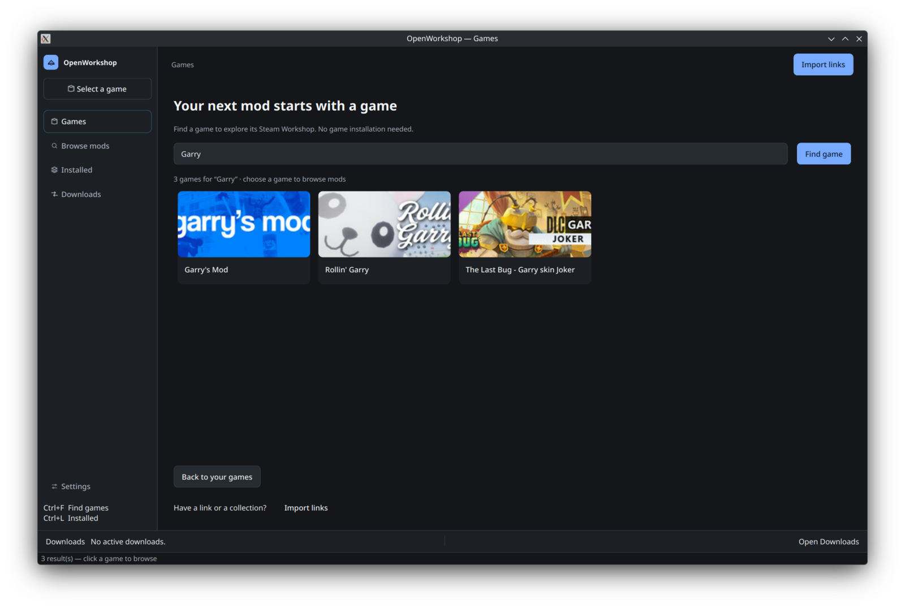
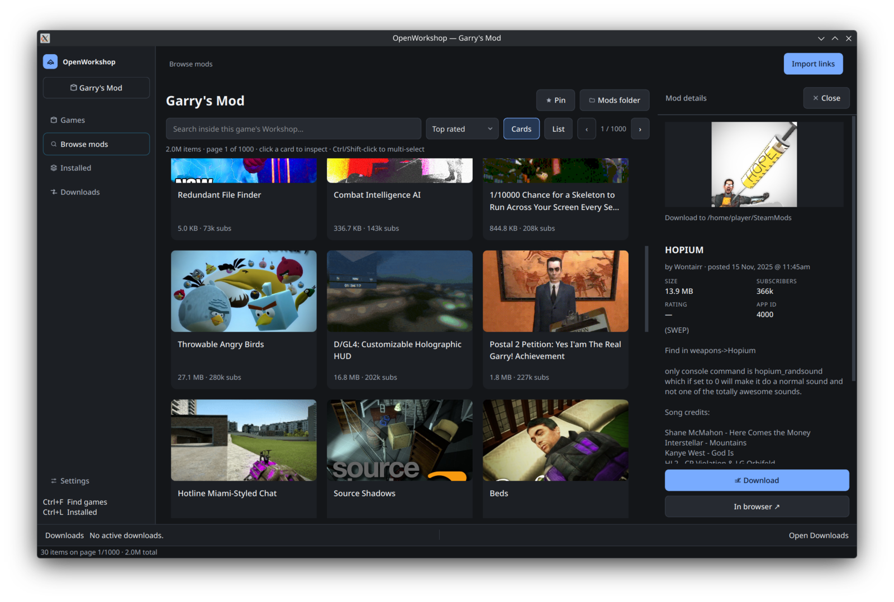

# OpenWorkshop

A desktop GUI for Valve's SteamCMD on Linux and Windows. Browse and download
Steam Workshop mods without owning or installing the game.



| Find a game | Inspect a mod |
| :---: | :---: |
|  |  |

## Why OpenWorkshop?

SteamCMD is powerful, but it is command-line only. OpenWorkshop gives it a
desktop interface:

- Browse a game's Workshop visually instead of typing SteamCMD commands
- Download individual mods or entire collections with a visible queue
- Works without owning or installing the game when the publisher allows it
- Sets up and manages SteamCMD for you

Some Workshop content still requires a Steam account with access to the game.

## Install

**Linux**

```bash
curl -fsSL https://raw.githubusercontent.com/adham-samir/openworkshop/main/install.sh | bash
openworkshop-gui
```

**Windows** — [download the latest release](https://github.com/adham-samir/openworkshop/releases/latest)
and follow the [setup guide](docs/installation.md#windows).

## Links

[Installation](docs/installation.md) · [User guide](docs/guide.md) ·
[CLI](docs/cli.md) · [Development](docs/development.md) · [MIT license](LICENSE)
