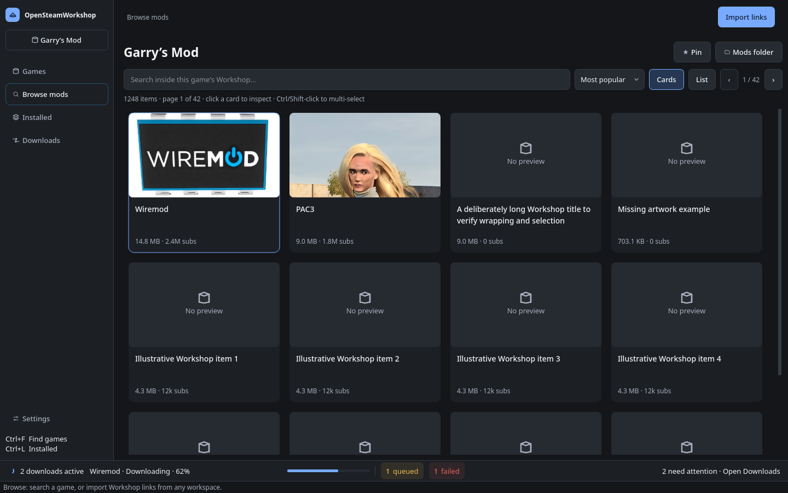

# OpenSteamWorkshop

[](https://github.com/adham-samir/OpenSteamWorkshop/actions/workflows/tests.yml)

Browse a game's Steam Workshop from a desktop app and download mods with Valve's
official **SteamCMD** — without installing the game. Anonymous downloads work
without owning the game when its publisher allows them.

- **Linux and Windows**, Python 3.10+
- **No SteamCMD setup**: the app downloads and manages it for you
- **Installed mods and updates**: see what is installed and when mods have newer versions
- **CLI included** (`osw`) for scripts and automation

---

## Install

### Linux

#### 1. One-line installer (recommended)

```bash
curl -fsSL https://raw.githubusercontent.com/adham-samir/OpenSteamWorkshop/main/install.sh | bash
```

This installs the latest release for your user — no `sudo` needed:

| What | Where |
| --- | --- |
| Application files | `~/.local/share/opensteamworkshop/` |
| `osw` and `osw-gui` commands | `~/.local/bin/` |
| App-menu entry | Added automatically |

After it finishes:

- Search for **OpenSteamWorkshop** in your application menu, or run `osw-gui`.
- If `~/.local/bin` is not on your `PATH`, the installer prints a note. Open a
  new terminal, or run `~/.local/bin/osw`.
- Remove everything again with:
  ```bash
  curl -fsSL https://raw.githubusercontent.com/adham-samir/OpenSteamWorkshop/main/uninstall.sh | bash
  ```
  Settings, the download queue and your downloaded mods are left untouched.

#### 2. pipx

```bash
pipx install https://github.com/adham-samir/OpenSteamWorkshop/releases/download/v0.6.1/opensteamworkshop-0.6.1-py3-none-any.whl
osw-gui
osw desktop-install   # optional: add the app-menu entry
```

Once the PyPI listing is live, `pipx install opensteamworkshop` will be enough.

#### 3. From a source checkout

```bash
git clone https://github.com/adham-samir/OpenSteamWorkshop.git
cd OpenSteamWorkshop
python3 -m venv --system-site-packages .venv
source .venv/bin/activate
pip install -e .
osw-gui
```

`osw desktop-install` adds the launcher entry; `osw desktop-uninstall` removes
it. The same toggle is in **Settings → Application menu**.

### Windows

The app-menu integration is Linux-only for now; on Windows, launch it from a
terminal or create a shortcut (steps below).

#### 1. Install Python

Install **Python 3.10 or newer** from
[python.org](https://www.python.org/downloads/windows/). During setup, tick
**Add python.exe to PATH**. Verify in PowerShell:

```powershell
py --version
```

#### 2. Download and install the app

1. Open the [latest release](https://github.com/adham-samir/OpenSteamWorkshop/releases/latest).
2. Download `opensteamworkshop-<version>-py3-none-any.whl`.
3. Install it (replace the path with your download folder):

```powershell
py -m pip install "$HOME\Downloads\opensteamworkshop-0.6.1-py3-none-any.whl"
```

`pip` installs PySide6 and the other dependencies automatically.

#### 3. Run it

```powershell
osw-gui
```

If Windows cannot find `osw-gui`, use the module form instead:

```powershell
py -m osw.gui.main_window
```

#### 4. Optional: Start-menu or desktop shortcut

Find the folder where Python puts its scripts:

```powershell
py -c "import sysconfig; print(sysconfig.get_path('scripts'))"
```

Open that folder, right-click `osw-gui.exe`, and choose **Pin to Start** or
**Send to → Desktop (create shortcut)**.

#### Updating and uninstalling

```powershell
# install a newer wheel from the releases page
py -m pip install --upgrade "$HOME\Downloads\opensteamworkshop-<version>-py3-none-any.whl"

# uninstall
py -m pip uninstall opensteamworkshop
```

Settings, the queue and your mods are not removed by the uninstaller. On
Windows they live in `C:\Users\<you>\.config\OpenSteamWorkshop`, plus your mods
folder (see **How it works**).

---

## Quick start

1. Launch **OpenSteamWorkshop** from your app menu (Linux) or with `osw-gui`.
2. Open **Games**, search for a game, and browse its Workshop in **Browse mods**.
3. Inspect a mod and click **Download**; follow progress in **Downloads**.
4. Open **Installed** to search local mods, check updates, or review duplicates.

Use the game switcher to revisit pinned/recent games. Browse mods and Installed
follow the selected game; Installed also offers **All games**. **Import links**
in the global header accepts item/collection links and IDs for a reviewable
preview. Imports and Downloads remain global when you switch games. Settings
sits at the bottom of the navigation.

Cards/list preference is remembered across launches; each game's search, sort,
page, artwork, scroll, and selection stay available during the current session.
Details open beside results in wide windows and as a dismissible page in smaller
ones. The persistent transfer strip opens Downloads from any workspace.



This native desktop capture uses illustrative counts and queue data. See the
[screenshot gallery and capture instructions](docs/screenshots/README.md) for more
states and artwork attribution.

Keyboard shortcuts: **Ctrl+F** Games search, **Ctrl+1** Browse mods, **Ctrl+2**
Import links, **Ctrl+3** Downloads, **Ctrl+4** Settings, **Ctrl+L** Installed,
and **/** Workshop search while browsing. **Escape** closes item details.

## Features

- **Browse and search** a game's Workshop with thumbnails, sorting, tags,
  dependencies, sizes and subscriber counts.
- **Download through SteamCMD** into `~/SteamMods` by default, with a visible,
  restart-safe queue.
- **Parallel downloads**: run up to three SteamCMD workers at once (three by
  default), each with its own workspace; items from the same game still
  download one at a time. Lower the count in Settings if needed.
- **Per-game mod folders**: deliver finished mods straight into a game's
  `Mods`/`addons` folder with a title-named folder.
- **Bulk imports**: paste item or collection URLs, resolve dependencies, review
  the list and queue the mods you want.
- **Installed library**: inspect, open, re-download or delete installed items.
- **Duplicate cleanup**: review installed items that exist in both the default
  mods root and a per-game folder, and delete the redundant copies.
- **Mod updates**: check manually or once a day; update single mods or review a
  batch with **Update all**.
- **Already-installed protection**: the app asks before re-downloading a mod;
  the CLI skips installed items unless you pass `--reinstall`.
- **Recent and pinned games** in Games and the searchable game switcher.

## Command line

`osw` exposes the same engine as the GUI:

```bash
osw search project zomboid
osw browse 108600 --sort toprated
osw browse 108600 --search "maps"
osw info 3820938264

# Download one or more items
osw download 108600 3820938264
osw download 108600 3820938264 --out ~/SteamMods

# Bulk downloads and collections
osw batch "https://steamcommunity.com/sharedfiles/filedetails/?id=..."
osw batch --input workshop-links.txt --with-dependencies

# Run up to three downloads at once (same-game items stay serialized)
osw batch --input workshop-links.txt --with-dependencies --parallel 2
osw settings --parallel 3   # default is already 3; lower it if needed

# Check for newer Workshop revisions, or fetch them all
osw updates 108600
osw updates 108600 --apply

# Report duplicate copies; --prune removes only the safe default copies
osw cleanup
osw cleanup --prune

# Installed items are skipped; --reinstall downloads them again
osw download 108600 3820938264 --reinstall

# Optional Steam account (password/Steam Guard are prompted when needed)
osw download 108600 3820938264 --username YOUR_STEAM_USERNAME

# Linux application-menu entry
osw desktop-install
osw desktop-uninstall
```

## How it works

**Where mods go.** By default, downloads land in
`<mods root>/steamapps/workshop/content/<appid>/<itemid>/`, with the mods root
defaulting to `~/SteamMods`. To deliver into a game's own folder, open **Browse mods**
→ game header → **Mods folder → Change…**. Finished items are moved to
`<chosen folder>/<Item title>/` and get a hidden `.opensteamworkshop.json`
marker. **Clear (use default)** restores the default root.

**Queue and settings.** The GUI queue is saved to
`~/.config/OpenSteamWorkshop/queue.json` and restored as interrupted work after
a restart; choose **Resume interrupted** to continue. Pinned games and per-game
folders and the optional cards/list preference live in `state.json` next to it. The same `.config/OpenSteamWorkshop`
folder is used on Windows (`C:\Users\<you>\.config\OpenSteamWorkshop`).
Changing Settings affects new jobs only; queued jobs keep their destination.

**Parallel downloads.** **Settings → Downloads → Concurrent games** (or `--parallel N`)
runs up to three jobs at a time. Extra workers use sibling workspaces such as
`steamcmd-w1`/`steamcmd-w2`, created automatically. Different games can run
together; two items from the same game still take turns so SteamCMD's
`appworkshop_<appid>.acf` is never written concurrently. The default is three
workers; lower it to 1 in Settings or with `--parallel 1`.

**Duplicates.** If an item exists both in the default tree and in a per-game
folder, the delivered copy is the live one and the default copy is leftover.
**Installed → Cleanup (N)** lists these and pre-ticks the safe default copies;
you can untick anything or choose between two delivered copies. The CLI's
`osw cleanup` reports the same groups, and `--prune` deletes only the safe
recommendation, never an ambiguous one.

**Updates.** Installed compares each installed item with Steam's latest public
revision. Default-folder items use SteamCMD's `appworkshop_<appid>.acf`;
delivered items use the revision recorded in their marker. Outdated rows show
**Update available**; **Update** re-downloads in place, and **Update all** lets
you untick items before queueing. Update checks, bulk updates, and duplicate cleanup follow the displayed
Installed scope and filters. Open mods folder opens the default mods root. Items with no recorded revision are shown as
**Version unknown** instead of being guessed at.

## Anonymous access and accounts

Anonymous login is the default. Whether it works depends on the game's Workshop
settings — it is not limited to free games — and Steam may deny some content.

To retry a failed download with an account, use **Retry with account** in
Downloads, or enable **Use this account for new downloads this session** in
Settings. The CLI needs an explicit `--username`; add `--anonymous` to force
anonymous mode. Passwords and Steam Guard codes are kept in memory only and are
never written to settings or queue files. For noninteractive scripts, `OSW_PASS`
can supply a password, but Steam Guard still needs a terminal.

## Troubleshooting

- **SteamCMD won't start on Linux** — install the 32-bit runtime:
  ```bash
  sudo apt install lib32gcc-s1        # Debian/Ubuntu
  sudo pacman -S lib32-gcc-libs       # Arch
  ```
- **`osw-gui` is not recognized on Windows** — use
  `py -m osw.gui.main_window`, or add Python's `Scripts` folder to `PATH`.
- **No app-menu entry on Linux** — run `osw desktop-install`, then search again.
  Some desktops need a log-out/log-in before the entry appears.
- **Access denied / No subscription** — Steam did not grant this login access.
  Retry with an account that owns the game or has Workshop access.
- **The first download quietly does nothing** — SteamCMD occasionally no-ops the
  first attempt; the app retries automatically.
- **The game has no Workshop** — some games publish mods elsewhere (for example
  Cities: Skylines II uses Paradox Mods); the app reports when a Workshop hub
  does not exist.

## Development

```bash
git clone https://github.com/adham-samir/OpenSteamWorkshop.git
cd OpenSteamWorkshop
python3 -m venv --system-site-packages .venv
source .venv/bin/activate
pip install -e '.[dev]'

QT_QPA_PLATFORM=offscreen python -m pytest -q
python -m ruff check osw tests
```

Tests use fake SteamCMD processes and fixture metadata: no Steam account, game
installation, API key or live downloads are needed.

## Legal and license

Workshop items belong to their authors. Use this tool for personal use within
Steam's terms; do not redistribute other people's content.

MIT licensed.
